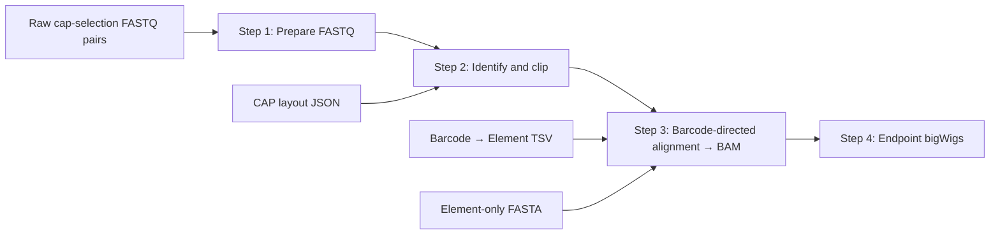

# Cap-selection workflow

This page documents the released **0.2.0b5** `cap-assay-pipeline` interface
and its handoffs. Step 2 named-field identification is mandatory, and Step 3
aligns each read pair natively to the Element selected by its barcode; STAR is
not used. Upgrading from an earlier release is a breaking change: see
[Migrating to 0.2.0b5](migrating-to-0.2.0b5.md).

## Two pipelines in one distribution

Installing the `reporter-assay-pipeline` Python package registers **four**
executables. Three (`yulab_reporter_pipe`, `yulab_reporter_qc`,
`yulab_reporter_export`) implement the **reporter-assay** path from paired-end
QUASARR-seq libraries to element-level activity calls. The fourth,
`cap-assay-pipeline`, implements the **cap-selection** path from cap-selected
cDNA sequencing to strand-selected RNA endpoint bigWig tracks.

The assays share plasmid construct context in the lab, but the command
namespaces, layout schemas, intermediate tables, and final deliverables are
not interchangeable. Reporter-assay Step 4 merges PreTran orientation counts;
cap-selection Step 4 consumes a library BAM and emits strand-selected
bigWigs (four tracks for `both`, two for `plus`/`minus`). Do not
mix step numbers or artifact names across the two workflows.

## Topology

| Step | Command | Role |
| --- | --- | --- |
| 1 | `step1-prep-fastq` | Adapter trim, 12-base R1 UMI in read names, ambiguous-UMI exclusion, fastp read filtering (`fastp`; UMI-aware dedup in Step 4) |
| 2 | `step2-identify-and-clip` | Match the CAP layout, extract normalized named captures into a `CAP1` read-name annotation, and retain one contiguous interval per mate; reject non-matching pairs with diagnostics |
| 3 | `step3-alignment` | Exact lookup of the selected `--barcode-field` captures in the barcode map, then native substitution/indel alignment of both mates to that one Element on the declared strand; coordinate-sorted BAM + BAI with rejection diagnostics |
| 4 | `step4-post-alignment-processing` | Pair filtering, UMI-tools paired deduplication, and strand-selected signed bigWig tracks + summary |

Every step is mandatory; Step 1 FASTQs cannot be passed directly to Step 3.
Each step is independently runnable on compatible artifacts: Step 3 accepts
externally prepared reads that carry a valid `CAP1` annotation, and Step 4
accepts **only** a compatible BAM without requiring Step 1–3 provenance.
The layout, barcode map, and element FASTA may be reused across libraries
that share a design.

There is no grouped whole-pipeline command: run each step explicitly with
compatible artifacts. See [Prepare inputs](prepare-inputs.md),
[Steps 1–3](steps-1-3.md), and the [Cap-selection CLI](../cli/cap-assay.md).
CAP has no XP runtime dependency.

## Step 3 → Step 4 handoff

The logical handoff is **BAM only** (not SAM, CRAM, or ad hoc tables). A
successful Step 3 invocation publishes, under `--output-dir`:

- `{prefix}_step3_alignment.bam` and `{prefix}_step3_alignment.bam.bai`
- `{prefix}_step3_summary.json`
- `{prefix}_step3_rejected_R1.fq.gz`, `{prefix}_step3_rejected_R2.fq.gz`, and
  `{prefix}_step3_rejections.tsv.gz` (diagnostics)

The BAM contains accepted, uniquely placed pairs only, in element-only
reference coordinates, with the captured fields in `xc:Z` and the resolved
Element in `xe:Z`. Step 4 does **not** require the BAI or these tags.
Externally produced BAMs are valid when they meet the same admission rules
(single read group matching `--library-prefix`, coordinate sort, and the rest
of the Step 4 input contract).

## Step 4 deliverable

Step 4 requires fastp-compatible UMI suffixes on every read name, filters
pairs for placement, CIGAR, combined edits, and geometry, then runs
**UMI-tools** paired deduplication on eligible pairs before building endpoint
bigWigs. Summary JSON reports `pre_dedup_eligible_pairs`,
`umi_duplicate_pairs_removed`, and retained `eligible_pairs` (see
[Cap-selection CLI — Step 4](../cli/cap-assay.md#step4-post-alignment-processing)).

A successful Step 4 invocation publishes strand-selected tracks under
`--output-dir` plus the summary (`{prefix}.step4_summary.json`):

| Step 4 `--rna-strand` | Published tracks |
| --- | --- |
| `both` (default) | `{prefix}.5pl.bw`, `{prefix}.5mn.bw`, `{prefix}.3pl.bw`, `{prefix}.3mn.bw` |
| `plus` | `{prefix}.5pl.bw`, `{prefix}.3pl.bw` |
| `minus` | `{prefix}.5mn.bw`, `{prefix}.3mn.bw` |

| File | Meaning |
| --- | --- |
| `{prefix}.5pl.bw` | R2 5′ **cap signal** on the plus biological RNA strand |
| `{prefix}.5mn.bw` | R2 5′ cap signal on the minus strand (negative stored values) |
| `{prefix}.3pl.bw` | R1-derived RNA 3′ **polymerase-position proxy** on the plus strand |
| `{prefix}.3mn.bw` | R1-derived proxy on the minus strand (negative stored values) |

Plus and minus are defined relative to the **element-only reference** record,
not genomic or plasmid physical orientation, and coordinates are positions
within the tested element. Track semantics, coordinates, and summary fields
are specified in [Cap format contracts](formats.md#step-4-endpoint-bigwigs)
and [Cap assay concepts](../cap-assay-concepts.md#two-endpoint-measurements).

## RNA strand policy

The strand value names the reference-relative biological RNA strand
determined by the R1 BAM strand (forward means plus; reverse means minus); it
never describes CW/CCW construct orientation.

- **Step 3** requires `--rna-strand plus` or `--rna-strand minus`. It has no
  default and no `both` mode. It searches only the declared R1 orientation
  and the opposite R2 orientation, so pairs from the other strand do not place
  and are rejected.
- **Step 4** accepts `--rna-strand {both,plus,minus}` (default `both`) as an
  assertion and track-selection policy. **Pass the same `plus` or `minus`
  value used at Step 3.** The BAM carries no policy marker: passing `both`
  for a single-strand BAM is accepted and only adds two empty tracks, while
  asserting the opposite strand fails Step 4 with its contradictory-pair count.

Each Step 3 invocation therefore processes one library on one known RNA
strand. Run minus-strand libraries with `--rna-strand minus` at both Steps 3
and 4.

## Where to read next

- [Prepare inputs](prepare-inputs.md) — layout JSON, barcode map, and element FASTA
- [Steps 1–3](steps-1-3.md) — typical filenames, summaries, and resumption checks
- [Cap-selection CLI](../cli/cap-assay.md) — every flag, Step 4 filtering, statuses, and a runnable example
- [Known limitations](known-limitations.md) — what the released cap workflow does not do
